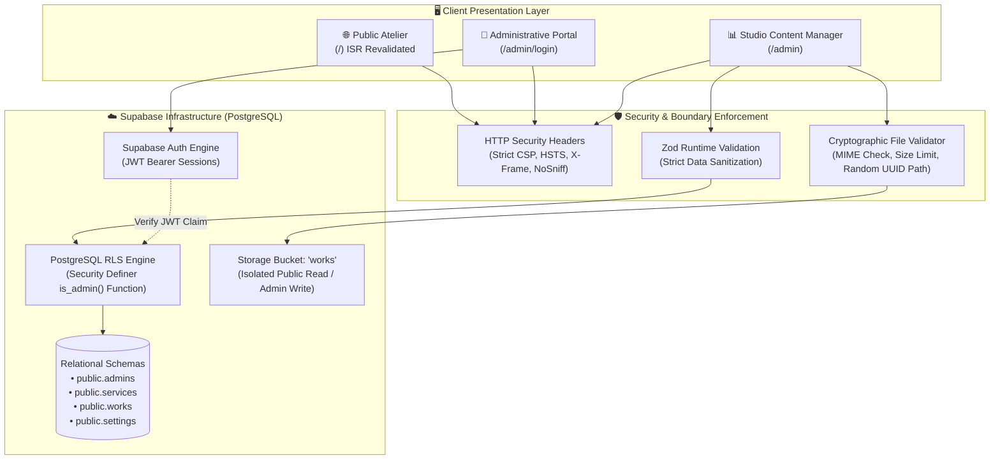
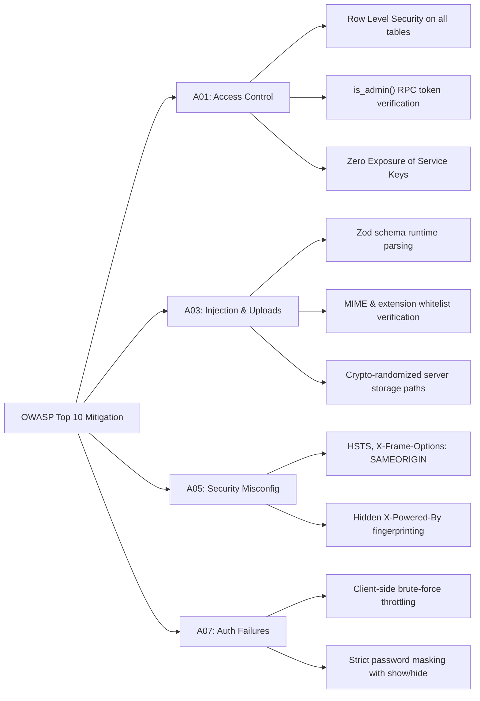

<div align="center">

# 🏛️ CLINIC HUB AGENCY
### Medical Atelier & Independent Healthcare Design Studio
**Bespoke Visual Identity, Luxury Clinical Stationery & Ethical Patient Acquisition**

[](https://nextjs.org/)
[](https://www.typescriptlang.org/)
[](https://tailwindcss.com/)
[](https://supabase.com/)
[](https://owasp.org/)
[](./LICENSE)

<br/>

> **"A medical clinic is never just a consultation room. It is a sacred identity and patient experience that begins long before the examination."**
<br/>

[Design Manifesto](#-anti-ai-design-manifesto) • [System Architecture](#-system-architecture) • [OWASP Security](#-enterprise-security--owasp-hardening) • [Database Blueprint](#-database-schema--sql-blueprint) • [Quick Start](#-quick-start--local-development) • [Deployment](#-production-deployment)

---

</div>

<br/>

## ⚜️ Anti-AI Design Manifesto

Clinic Hub Agency was built upon a deliberate **Anti-AI Design Philosophy**, inspired by Swiss typographic grids, European architectural monographs, and tactile fine-stationery ateliers. We actively reject the disposable tropes of AI-generated SaaS templates:

```
┌────────────────────────────────────────────────────────────────────────┐
│  BESPOKE EDITORIAL CRAFT VS. AI-GENERATED TEMPLATES                    │
├────────────────────────────────┬───────────────────────────────────────┤
│ ❌ REJECTED AI CLICHÉS         │ ✅ BESPOKE ATELIER CRAFTSMANSHIP      │
├────────────────────────────────┼───────────────────────────────────────┤
│ • Neon radial background blurs │ • Architectural hairline rules & grid │
│ • Iridescent gradient text     │ • Stark monochrome & matte brass foil │
│ • Bulbous rounded-pill buttons │ • Crisp, sharp architectural buttons  │
│ • Generic "Why Us" 4-card grids│ • Tangible clinical standards essay   │
│ • Cartoonish floating badges   │ • Real 300 DPI physical print specimen│
│ • Pulsing green pinging buttons│ • Understated concierge communication │
└────────────────────────────────┴───────────────────────────────────────┘
```

<br/>

### ✒️ Master Typography Specimen

| Typeface | Functional Role | Editorial Purpose |
| :--- | :--- | :--- |
| **Reem Kufi** | Editorial Display & Hero | Imparts clinical gravitas, artistic authority, and authentic calligraphic poise. |
| **Cairo** | Subheadings & Numerical Scale | Provides sharp visual hierarchy with weights ranging from Medium (500) to Black (900). |
| **IBM Plex Sans Arabic** | Clinical Body Text | Engineered by Mike Abbink & Wael Morcos for maximum legibility and zero visual fatigue. |
| **Plus Jakarta Sans** | Latin Labels, Codes & Colophons | Gives architectural precision to metadata tags, RX numbers, and technical specifications. |

---

<br/>

## 🏛️ System Architecture

The application marries **Next.js 14 App Router** (leveraging Incremental Static Regeneration at 60-second intervals for sub-millisecond edge delivery) with **Supabase PostgreSQL** protected by strict **Row Level Security (RLS)**.



---

<br/>

## 🛡️ Enterprise Security & OWASP Hardening

Every user interaction, data mutation, and file upload is rigorously defended according to the **OWASP Top 10** enterprise guidelines:



### 📋 Security Implementation Matrix:

| OWASP Standard | Vulnerability Addressed | Architectural Implementation | Target File |
| :--- | :--- | :--- | :--- |
| **A01: Broken Access Control** | Unauthorized privilege escalation into Admin zones. | Multi-tier validation: Supabase JWT session check combined with PostgreSQL `public.is_admin()` database function and RLS policies. | [`src/app/admin/page.tsx`](./src/app/admin/page.tsx)<br/>[`supabase/schema.sql`](./supabase/schema.sql) |
| **A03: Unrestricted Upload** | Malicious executable upload (PHP/WebShell) and Directory Traversal. | Strict MIME-type verification (`image/jpeg`, `image/png`, `image/webp`), 8MB ceiling, and randomized server paths via `crypto.randomUUID()`. | [`src/lib/validation.ts`](./src/lib/validation.ts)<br/>[`src/components/admin/WorksManager.tsx`](./src/components/admin/WorksManager.tsx) |
| **A03: Cross-Site Scripting (XSS)** | Malicious protocol injection (`javascript:`) via WhatsApp or Instagram links. | Strict text stripping (tag neutralization), digits-only phone normalization, and sanitized handles. | [`src/lib/validation.ts`](./src/lib/validation.ts)<br/>[`src/lib/wa.ts`](./src/lib/wa.ts) |
| **A05: Security Misconfiguration** | Clickjacking, MIME sniffing, and server fingerprinting. | Strict HTTP headers in `next.config.mjs` (`X-Frame-Options: SAMEORIGIN`, `X-Content-Type-Options: nosniff`, `poweredByHeader: false`). | [`next.config.mjs`](./next.config.mjs) |
| **A07: Identification Failures** | Automated credential stuffing and brute-force attacks. | Adaptive client-side attempt tracking with automatic lockouts after repeated failures. | [`src/app/admin/login/page.tsx`](./src/app/admin/login/page.tsx) |
| **Zero Exposure Rule** | Accidental leakage of service role credentials to client bundles. | Client queries utilize strictly scoped Publishable Anon Keys; Service Role Key is isolated to backend operations. | [`src/lib/supabase.ts`](./src/lib/supabase.ts)<br/>[`.env.local`](./.env.example) |
| **Fault Resilience** | Fatal client-side render exceptions crashing the application. | High-fidelity React `ErrorBoundary` with graceful recovery UI. | [`src/components/ErrorBoundary.tsx`](./src/components/ErrorBoundary.tsx) |

---

<br/>

## 📁 Codebase Directory Structure

```bash
clinic-hub-agency/
├── 📁 supabase/
│   └── schema.sql                  # PostgreSQL schemas, RLS policies, storage bucket & admin functions
├── 📁 src/
│   ├── 📁 app/
│   │   ├── 📁 admin/
│   │   │   ├── 📁 login/
│   │   │   │   └── page.tsx        # Secure authentication entry point with brute-force delay
│   │   │   └── page.tsx            # Tabbed administrative dashboard (Works, Services, Channels)
│   │   ├── globals.css             # Architectural CSS, hairline borders, print drawing keyframes
│   │   ├── layout.tsx              # Root HTML layout, OpenGraph metadata, typography preconnects
│   │   └── page.tsx                # Public-facing studio showcase (ISR 60-second cache)
│   ├── 📁 components/
│   │   ├── 📁 admin/
│   │   │   ├── ServicesManager.tsx # Medical scope editor with inline toggles & order management
│   │   │   ├── SettingsManager.tsx # WhatsApp, Instagram & email channel configurations
│   │   │   ├── WorksManager.tsx    # Drag-and-drop file uploader with live thumbnail inspection
│   │   │   └── ui.tsx              # Reusable architectural form fields, buttons & confirm modals
│   │   ├── Contact.tsx             # Official correspondence channels & studio colophon
│   │   ├── ErrorBoundary.tsx       # Fail-safe component boundary preventing crash loops
│   │   ├── FloatingWhatsApp.tsx    # Restrained studio concierge action widget
│   │   ├── Header.tsx              # Studio masthead with scroll-adaptive glass & mobile navigation
│   │   ├── Hero.tsx                # Manifesto headline with tactile 300 DPI prescription specimen
│   │   ├── Portfolio.tsx           # Selected works archive with modal inspection lightbox
│   │   ├── Services.tsx            # Numbered disciplines ledger ([01], [02], [03])
│   │   └── StudioPhilosophy.tsx    # Clinical standards essay on medical ethics & print engineering
│   └── 📁 lib/
│       ├── data.ts                 # Data fetching layer with fallback handling
│       ├── supabase.ts             # Instantiated client using public anon credentials
│       ├── types.ts                # TypeScript interface declarations for Work, Service & Settings
│       ├── utils.ts                # Class name merging utility (clsx + tailwind-merge)
│       ├── validation.ts           # Zod schemas & cryptographic storage path generation
│       └── wa.ts                   # Sanitized WhatsApp link generator with URI-encoded prompts
├── .env.example                    # Template for required environment variables
├── .npmrc                          # Registry configuration pinning to official npmjs registry
├── LICENSE                         # MIT License with commercial healthcare advisory
├── next.config.mjs                 # Strict security headers, remote patterns & image optimization
├── package.json                    # Project dependencies & execution scripts
├── tailwind.config.ts              # Custom architectural color palette (ink, paper, brass)
└── tsconfig.json                   # Strict TypeScript compiler options
```

---

<br/>

## 🗄️ Database Schema & SQL Blueprint

Execute the following DDL once in your **Supabase > SQL Editor** to bootstrap all necessary tables, security functions, storage policies, and initial records:

```sql
create extension if not exists "pgcrypto";

-- 1. Administrative Users Table
create table if not exists public.admins (
  email text primary key
);

-- 2. Medical Disciplines & Services Table
create table if not exists public.services (
  id uuid primary key default gen_random_uuid(),
  title text not null,
  description text not null default '',
  sort_order int not null default 0,
  is_active boolean not null default true,
  created_at timestamptz not null default now()
);

-- 3. Selected Clinical Works & Stationery Table
create table if not exists public.works (
  id uuid primary key default gen_random_uuid(),
  title text not null,
  clinic_name text not null default '',
  service_id uuid references public.services(id) on delete set null,
  image_url text not null,
  image_path text not null,
  is_published boolean not null default true,
  sort_order int not null default 0,
  created_at timestamptz not null default now()
);

-- 4. Global Studio Settings Table
create table if not exists public.settings (
  id int primary key default 1 check (id = 1),
  whatsapp text not null default '',
  instagram text not null default '',
  email text not null default ''
);

insert into public.settings (id) values (1) on conflict (id) do nothing;

-- 5. Security Definer Authorization Function
create or replace function public.is_admin()
returns boolean
language sql
security definer
stable
set search_path = public
as $$
  select exists (
    select 1 from public.admins where lower(email) = lower(coalesce(auth.jwt() ->> 'email', ''))
  );
$$;

-- 6. Row Level Security Policies
alter table public.admins   enable row level security;
alter table public.services enable row level security;
alter table public.works    enable row level security;
alter table public.settings enable row level security;

create policy "services read"  on public.services for select using (is_active or public.is_admin());
create policy "services write" on public.services for all using (public.is_admin()) with check (public.is_admin());

create policy "works read"  on public.works for select using (is_published or public.is_admin());
create policy "works write" on public.works for all using (public.is_admin()) with check (public.is_admin());

create policy "settings read"  on public.settings for select using (true);
create policy "settings write" on public.settings for all using (public.is_admin()) with check (public.is_admin());

-- 7. Storage Bucket & File Security Policies
insert into storage.buckets (id, name, public) values ('works', 'works', true) on conflict (id) do nothing;

create policy "works images public read" on storage.objects for select using (bucket_id = 'works');
create policy "works images admin insert" on storage.objects for insert with check (bucket_id = 'works' and public.is_admin());
create policy "works images admin update" on storage.objects for update using (bucket_id = 'works' and public.is_admin());
create policy "works images admin delete" on storage.objects for delete using (bucket_id = 'works' and public.is_admin());

-- 8. Seed Initial Medical Practices
insert into public.services (title, description, sort_order) values
  ('تصميم الروشتات والمطبوعات الطبية', 'روشتة فاخرة بهندسة مريحة ليد الطبيب، هوامش دقيقة، وطباعة معتمدة بأعلى أوزان الورق.', 1),
  ('إعلانات السوشيال ميديا والحملات', 'إدارة حملات موجهة جغرافياً لجلب المرضى القريبين من العيادة بما يتوافق مع أخلاقيات النقابة.', 2),
  ('الهوية البصرية واللافتات للعيادات', 'تصميم الشعار، باليت الألوان، لوحات العيادة الخارجية، وبطاقات الحجز والمتابعة.', 3);
```

---

<br/>

## ⚡ Quick Start & Local Development

### Prerequisites
- **Node.js**: v18.18+ or v20+ (Node v24 tested)
- **npm**: v10+
- A free or pro project on [Supabase](https://supabase.com)

### 1. Clone & Install Dependencies
```bash
git clone https://github.com/your-username/clinic-hub-agency.git
cd clinic-hub-agency
npm install
```

### 2. Configure Environment Variables
Create a `.env.local` file in the project root:
```env
NEXT_PUBLIC_SUPABASE_URL=https://your-project.supabase.co
NEXT_PUBLIC_SUPABASE_ANON_KEY=your-publishable-anon-key
SUPABASE_SERVICE_ROLE_KEY=your-secret-service-role-key
NEXT_PUBLIC_WHATSAPP=201000000000
```

### 3. Bootstrap Database & Admin Access
1. Execute [`supabase/schema.sql`](./supabase/schema.sql) in your **Supabase SQL Editor**.
2. Register your administrative email in the `admins` table:
   ```sql
   insert into public.admins (email) values ('your-email@example.com');
   ```
3. Navigate to **Authentication > Users** in Supabase and click **Add User > Create User** with that same email and a secure password.

### 4. Run Development Server
```bash
npm run dev
```
Navigate to:
* **Public Atelier:** `http://localhost:3000`
* **Studio Management Portal:** `http://localhost:3000/admin`
* **Authentication Screen:** `http://localhost:3000/admin/login`

### 5. Validate TypeScript & Production Build
```bash
# Strict Typecheck (Zero Error Tolerance)
npm run typecheck

# Production Optimization & Static Generation
npm run build
```

---

<br/>

## 🚢 Production Deployment

### Recommended: Vercel (Edge-Optimized)
1. Push your repository to GitHub / GitLab.
2. Import the project into [Vercel](https://vercel.com).
3. Add the environment variables:
   * `NEXT_PUBLIC_SUPABASE_URL`
   * `NEXT_PUBLIC_SUPABASE_ANON_KEY`
   * `NEXT_PUBLIC_WHATSAPP`
4. Deploy. Next.js App Router will generate static HTML snapshots while maintaining on-demand **ISR** revalidation every 60 seconds whenever content is updated via the Studio Manager.

---

<br/>

## 📄 License & Intellectual Property

Distributed under the **MIT License** — see [`LICENSE`](./LICENSE) for full legal text.

### Commercial Healthcare Advisory
* **Trademark & Portfolio Rights:** The trade name "Clinic Hub Agency", marks, branding assets, and client showcase photographs remain the reserved intellectual property of Clinic Hub Agency.
* **Medical Compliance:** Entities deploying this software commercially remain strictly responsible for compliance with regional medical advertising laws and national medical syndicate regulations.

<div align="center">
<br/>
<sub>Crafted with architectural precision, typographical discipline, and uncompromising security for <b>Clinic Hub Agency</b> © 2026.</sub>
</div>
